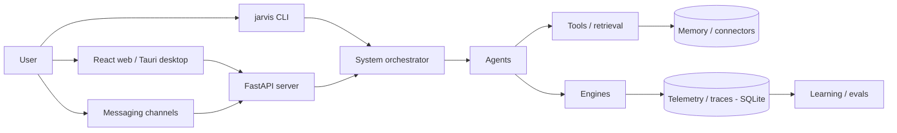

# Architecture — OpenJarvis

> Harness-level system map: modules, data flow, and design decisions. Update whenever module boundaries change. Detailed per-subsystem docs live in [`docs/architecture/`](architecture/overview.md).

## System overview

OpenJarvis is a local-first personal AI framework: shared primitives (engines, agents, tools, memory, learning) for on-device agents, with energy, FLOPs, latency and cost as first-class constraints alongside accuracy. The cloud is used only when necessary.

## High-level diagram

## Modules

All paths under `src/openjarvis/` unless noted.

- `engine/` — inference backends (Ollama, vLLM, llama.cpp, MLX, Apple FM, LiteLLM, cloud)
- `agents/` — agents incl. `morning_digest`, `deep_research`, `orchestrator`, `hybrid/`
- `tools/` — agent tools; `tools/storage/` holds BM25 / FAISS / ColBERT / hybrid retrieval
- `memory/`, `connectors/` — personal-data ingestion (Gmail, Calendar, Oura, Notion, …)
- `channels/` — ~35 messaging integrations
- `server/` — optional FastAPI app + routes
- `cli/` — `jarvis` Click commands
- `telemetry/`, `traces/` — energy monitors and per-call SQLite telemetry
- `learning/`, `evals/`, `bench/` — optimization, eval scorers, benchmarks
- `security/`, `sandbox/` — guardrails, audit log, Docker/WASM sandbox
- `scheduler/`, `daemon/`, `skills/`, `mcp/`, `a2a/`, `speech/`, `workflow/`
- `core/` — config, `registry.py` (component registration), `events.py` (`EventBus`)
- `rust/crates/*` — Rust workspace mirroring core subsystems; PyO3 ext `openjarvis_rust` via `_rust_bridge.py`
- `frontend/` — React UI; `frontend/src-tauri/` — Tauri 2 desktop shell (bundles Ollama sidecar)

### Scheduled task runtime (D-008 – D-013)

`jarvis scheduler start` (`cli/scheduler_service_cmd.py`) is the only runner of scheduled tasks; `jarvis serve` does not run them.

- **Responsibility:** run due tasks unattended, at most once per slot, within the user's allowlists.
- **Interface:** `TaskScheduler(store, system, bus=, policy=)` with `run_pending()`; `scheduler/policy.py` (`RunPolicy`, `missed_by`, `audit_line`); `scheduler/runtime.py` (`OnDemandSystem.ask`); `daemon/scheduler_service.py` (launchd `install`/`uninstall`/`status`, single-instance lock).
- **Hidden:** the store's compare-and-set claim (`next_run` advances before execution), a fresh `JarvisSystem` per run with credentials loaded from `credentials.toml`, and the process-wide tool allowlist (`security/tool_allowlist.py`), set once at daemon startup and enforced on every call in `ToolExecutor.execute` (so tools an agent adds for itself are covered too); `system/orchestrator.py` also drops disallowed tools from what agents are offered. External-CLI agents (`claude_code`, `opencode`) and the hybrid agents (`agents/hybrid`) bypass the executor and are guarded only by `allowed_agents`. `TaskScheduler.run_now` is the single manual-run path (`jarvis scheduler run-task`): same run, log and events, but no claim and no policy checks.
- **Events:** `SCHEDULER_TASK_START` / `SCHEDULER_TASK_END` on the daemon's private `EventBus`; END carries `agent`, `outcome` (`success|failed|skipped|missed`), and `started_at`. `agents/digest_playback.py` (`DigestAutoplay`) listens for END and plays fresh digest audio via `speech/playback.py` when `digest.autoplay` is on, so the generic scheduler never knows about digests.

For each module, document:
- **Responsibility:** one-line statement of what it owns.
- **Interface:** the narrow surface other modules use to interact with it.
- **Hidden:** what the module deliberately keeps private.
- **Why deep:** what complexity this module absorbs so callers don't have to.

## Data flow

{{TODO: trace the canonical request end-to-end (e.g. `jarvis ask` → system orchestrator → agent → engine → telemetry). See docs/architecture/query-flow.md.}}

## Persistence model

SQLite databases under `OPENJARVIS_HOME` for telemetry, traces, sessions, audit log, and digests. Optional vector/keyword indexes (FAISS, ColBERT, BM25) for retrieval. Configuration in TOML (`configs/`, `OPENJARVIS_CONFIG`).

{{TODO: key tables, relationships, and migration strategy.}}

## External dependencies

- **Inference:** Ollama, vLLM, llama.cpp, MLX, Apple Foundation Models, LiteLLM, OpenAI/Anthropic APIs
- **Server/CLI:** FastAPI, uvicorn, Pydantic, Click, Rich
- **Retrieval/ML:** faiss-cpu, sentence-transformers, dspy, datasets
- **Speech:** faster-whisper, kokoro, Cartesia (digest TTS)
- **Rust:** tokio, rusqlite, reqwest, rig-core, wasmtime, pyo3
- **Frontend/desktop:** React, Vite, Tailwind, zustand, Tauri 2

For each, document **why** this dependency exists and **what would have to change** if it were removed.

## Design decisions (ADRs)

Record significant decisions inline here or as separate files in `docs/decisions/`. Each entry: Decision, Context, Alternatives considered, Trade-offs accepted.

### Initial decisions

- **Local-first with cloud fallback** — privacy and cost; trade-off is hardware-dependent quality and many engine backends to maintain.
- **Registry + EventBus for components** — new engines/agents/tools plug in without editing callers; trade-off is indirection when tracing code.
- **Rust core mirrored via PyO3** — performance and a future native runtime; trade-off is keeping Python and Rust in sync and a local build step.
- {{TODO: further decisions}}

## Open architectural questions

{{TODO: list unresolved questions.}}

## How this doc stays accurate

Update this doc as part of the Definition of Done whenever a module is added/removed, an interface or data flow changes, a significant dependency is added, or a design decision is reversed. The `architect` subagent reads this file at the start of every non-trivial change.
